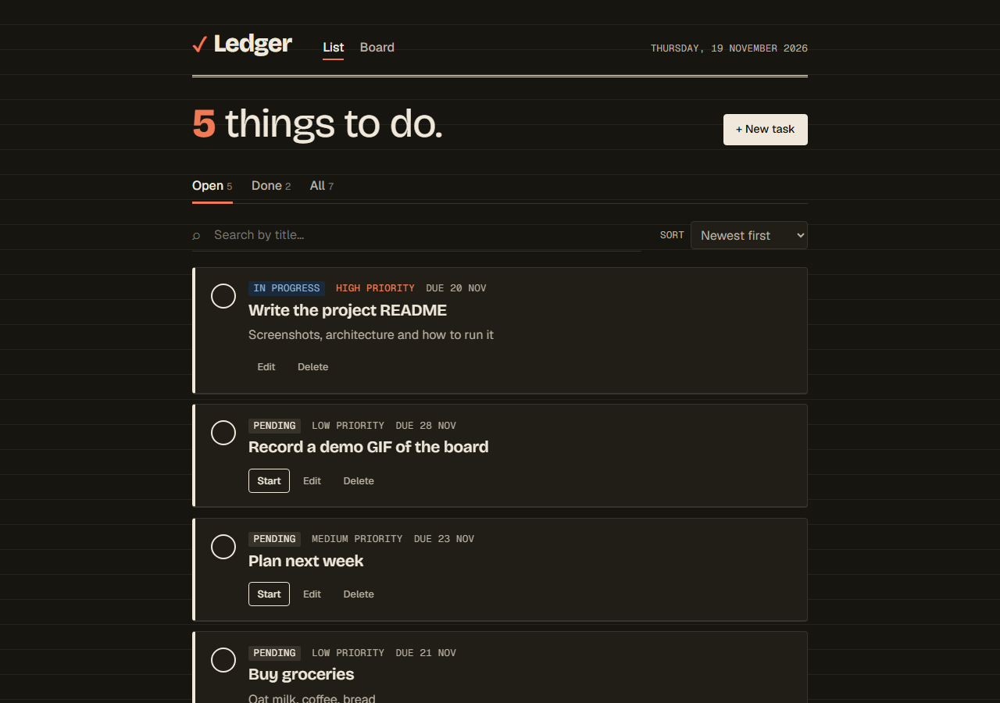
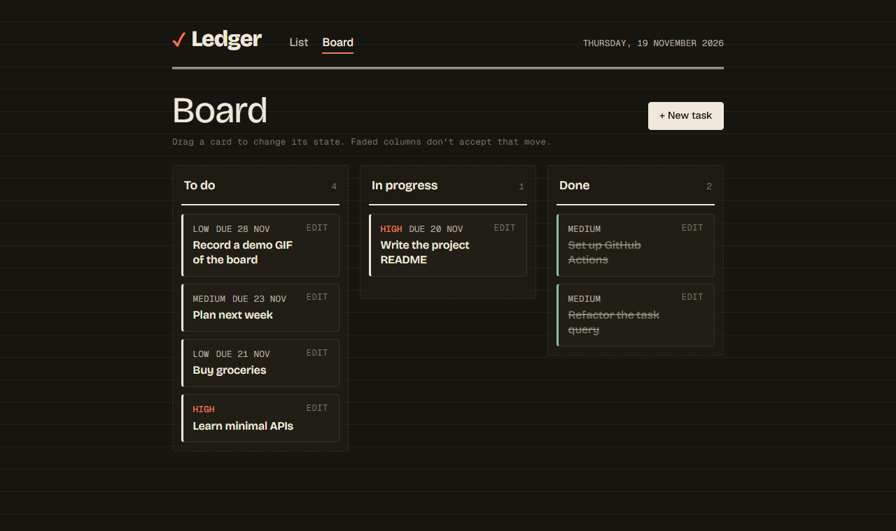
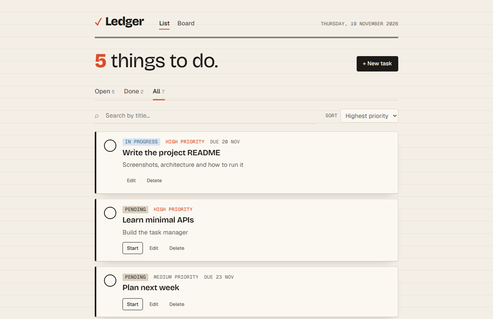

# Ledger

[](https://github.com/LeonelSaabDev/ledger-tasks-fullstack/actions/workflows/ci.yml)

**A personal task manager built with ASP.NET Core 10, Clean Architecture, SQL Server and Angular 22.**

Tasks move through a small, strict lifecycle (`Pending` → `InProgress` → `Completed`, and back with *reopen*). The same rules drive everything: the domain model, the API endpoints, and a kanban board where a card can only be dropped where the domain allows it.



## Highlights

- **A state machine, not a status field.** Nobody can set `Status` directly. Changes go through `Start()`, `Complete(now)` and `Reopen()`, and `CompletedAt` is always set if and only if the task is completed.
- **A kanban board that respects the domain.** Dragging a card calls the matching action. Moves the domain does not support (for example `InProgress` → `Pending`) are blocked, and the columns light up or fade to show it while you drag.
- **Optimistic updates with rollback.** On the board a card moves instantly. If the API rejects the move or is unreachable, the board puts everything back and explains why.
- **Server-side search, sorting and paging.** One `TaskQuery` holds the logic as plain LINQ, so EF Core runs it as SQL and the unit tests run the same code in memory.
- **The URL is the list state.** Filters, search, sort and page live in the query string: reload-safe, shareable, and the back button works.
- **Errors that make sense.** Business rule violations return `400`, unknown ids return `404`, both as RFC 9457 problem details, and the UI shows the API's own message.
- **Built test first.** 34 backend tests (xUnit, written with TDD from the first domain rule) and 32 frontend tests (Vitest).
- **One command to run it all.** Docker Compose starts SQL Server, applies the migrations, and serves the API and the web app. GitHub Actions runs every test on each push.

## Tech stack

| Layer | Technology |
|-------|------------|
| API | ASP.NET Core 10 (Minimal APIs), problem details, OpenAPI |
| Persistence | Entity Framework Core 10, SQL Server |
| Frontend | Angular 22 (zoneless, signals, `rxResource`, `linkedSignal`), Angular CDK drag and drop, plain CSS with design tokens and dark mode |
| Tests | xUnit + `FakeTimeProvider` (backend), Vitest + Angular TestBed (frontend) |
| Delivery | Docker multi-stage images, nginx, Docker Compose, GitHub Actions |

## Getting started

### Quick start with Docker

The only requirement is [Docker Desktop](https://www.docker.com/products/docker-desktop/).

1. **Create the secrets file.** Copy `.env.example` to `.env` and set a SQL Server password. `.env` is git-ignored.
2. **Start everything** (the first build takes a few minutes):

   ```bash
   docker compose up --build -d
   ```

3. Open **http://localhost:8080**.

| Container | Role |
|-----------|------|
| `db` | SQL Server 2022. Its data lives in the `sqldata` volume, so it survives restarts. Reachable from this machine on `localhost,14330`. |
| `migrate` | Runs `migrate` once to create or upgrade the schema, then exits. The API waits for it to succeed. |
| `api` | The ASP.NET Core API, not published to the host. |
| `web` | nginx serving the Angular build and forwarding `/api` to the API, so the browser sees a single origin and needs no CORS. |

Stop it with `docker compose down`. Add `-v` to also delete the database.

### Local development

Requirements: .NET 10 SDK, Node 24, a local SQL Server and the `dotnet-ef` tool.

```bash
# 1. Create the database (connection string in backend/src/TaskManager.Api/appsettings.Development.json)
dotnet ef database update --project backend/src/TaskManager.Infrastructure --startup-project backend/src/TaskManager.Api

# 2. API on http://localhost:5109
dotnet run --project backend/src/TaskManager.Api

# 3. Angular on http://localhost:4200 (in another terminal)
npm --prefix frontend install
npm --prefix frontend start
```

### Running the tests

```bash
dotnet test backend/TaskManager.slnx
npm --prefix frontend test -- --watch=false
```

## Screenshots

| Board (dark) | List (light) |
|--------------|--------------|
|  |  |

## Architecture

```
backend/
├── src/
│   ├── TaskManager.Domain/          TaskItem and its rules. No dependencies.
│   ├── TaskManager.Application/     Use cases (TaskService), TaskQuery, DTOs, repository contract
│   ├── TaskManager.Infrastructure/  EF Core: DbContext, mapping, migrations, repository
│   └── TaskManager.Api/             Minimal API endpoints, error handling, composition root
└── tests/
    ├── TaskManager.Domain.Tests/
    └── TaskManager.Application.Tests/

frontend/src/app/features/tasks/
├── data-access/   Models, HTTP client, URL query parsing, board rules (pure functions)
├── components/    Presentational: task card, board card, form, pager
└── pages/         Containers: list, board, create/edit form
```

Dependencies point inward: `Api → Application ← Infrastructure`, and everything depends on `Domain`. Application defines `ITaskRepository`; Infrastructure implements it with EF Core. On the frontend, pages own data and API calls, while components only render inputs and emit events.

### Lifecycle

```
Pending ──start──▶ InProgress ──complete──▶ Completed
   └───────────────complete─────────────────▶   │
   ◀────────────────reopen───────────────────────┘
```

Title, notes, priority and due date can be edited in any state, including `Completed`. Editing never changes the status.

### API

| Method | Route | Purpose |
|--------|-------|---------|
| `GET` | `/api/tasks?view=&search=&priority=&sortBy=&direction=&page=&pageSize=` | Paged, filtered, sorted list |
| `GET` | `/api/tasks/summary` | Open, done and overdue counters |
| `GET` | `/api/tasks/{id}` | One task |
| `POST` | `/api/tasks` | Create |
| `PUT` | `/api/tasks/{id}` | Edit details |
| `POST` | `/api/tasks/{id}/start` · `/complete` · `/reopen` | State transitions |
| `DELETE` | `/api/tasks/{id}` | Delete |

`view` is `Open`, `Done` or `All`. `sortBy` is `CreatedAt`, `DueDate` or `Priority`. Values are case-sensitive, and invalid values return `400`.

## Engineering notes

Problems found while building and testing this project, and how each one was solved.

| Problem | Fix |
|---------|-----|
| Tests that depend on the clock are flaky | Time is a parameter (`Complete(now)`), and services use an injected `TimeProvider` (`FakeTimeProvider` in tests). |
| Dates read back from SQL Server lost their UTC marker, so the browser shifted them by the local offset | A value converter marks `CreatedAt` and `CompletedAt` as UTC when reading. |
| Priority is stored as text, so `ORDER BY` gave `High < Low < Medium` | Sorting ranks priorities explicitly (`Low=0`, `Medium=1`, `High=2`). |
| An invalid query value such as `?view=Banana` returned `500` | The exception handler maps `BadHttpRequestException` to its own status code (`400`). |
| Searching had to behave the same in memory and in SQL | Both sides are lower-cased before `Contains`, matching case-insensitively everywhere. |
| A `<select [value]>` ignored the URL on first load, because the options did not exist yet | Each option binds `[selected]` instead. |
| A due date is a calendar day, not an instant | It is a `DateOnly` in .NET and is compared with the user's local date in Angular. |

## Scope

Ledger is a single-user app meant to run locally, so it has no authentication. Exposing it on the internet would need at least a login.
